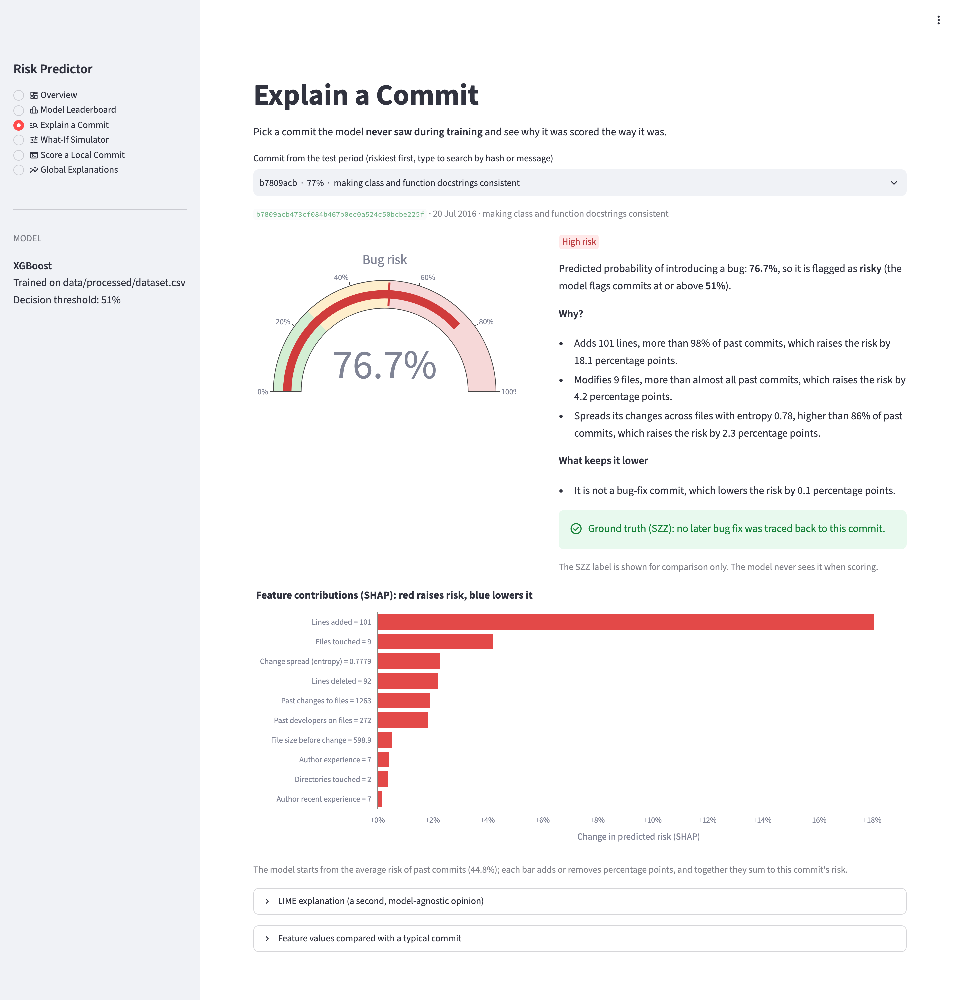
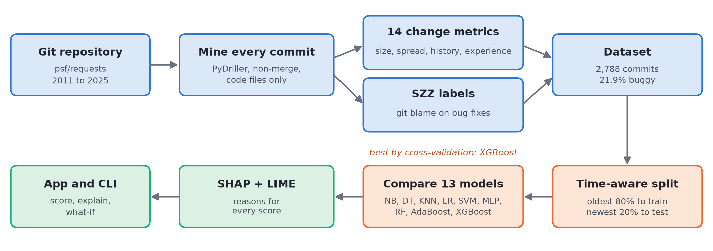

# Explainable Code Change Risk Predictor

[](https://github.com/AKSHATSPAR/code-change-risk-predictor/actions/workflows/tests.yml)
[](https://code-change-risk-predictor.streamlit.app)

This project looks at a git commit and estimates how likely it is to introduce a bug. It also tells you why, in plain English, so the score is something a developer can actually act on.

In research papers the idea is usually called *just-in-time defect prediction*.

**Try it online:** [code-change-risk-predictor.streamlit.app](https://code-change-risk-predictor.streamlit.app). If nobody has opened it for a while it takes about 30 seconds to wake up.



## Why bother?

Nobody has time to review every commit with the same care. A one-line typo fix and a 600-line refactor often get about the same attention in code review, even though one of them is far more likely to break something. If a model can point at the small group of commits that carry most of the risk, reviewers know where to look first.

A bare number like "73% risky" isn't much help on its own, though. People want to know what made it risky. So every prediction here comes with reasons like *"Adds 91 lines, more than 96% of past commits, which raises the risk by 18 percentage points."*

## How it works



1. **Mining** (`mining.py`). We walk through the whole history of a repository, oldest commit first, and compute 14 measurements for every commit that changes code. Anything about history or experience only looks at commits that came *before*, so the model never peeks into the future.
2. **Labelling** (`labeling.py`). We use the SZZ algorithm. First we find commits whose message says they fix a bug. Then we run `git blame` on the lines each fix changed, and whichever commit last touched those lines gets labelled as bug-introducing.
3. **Dataset** (`build_dataset.py`). Features and labels go into `data/processed/dataset.csv`. We drop the newest 180 days because bugs in very recent commits usually haven't been found yet.
4. **Models** (`modeling.py`, `train.py`). We compare 13 classic algorithms, try class weights and SMOTE for the class imbalance, tune the stronger models, and pick a winner using cross-validation on the training period only. The newest 20% of commits are kept aside as the test set.
5. **Explanations** (`explain.py`). SHAP shows what drives risk overall and for each single commit. LIME gives a second opinion. Both get turned into readable sentences.
6. **App** (`app/streamlit_app.py`, `cli.py`). Score any commit, see why it was flagged, and play with a what-if simulator.

## The 14 features

These come from Kamei et al. (2013), which is the standard set for this problem.

| Group | Feature | What it measures |
|---|---|---|
| Diffusion | `ns` | top-level subsystems (directories) touched |
| | `nd` | directories touched |
| | `nf` | code files touched |
| | `entropy` | how evenly the change is spread over those files (0 means one file) |
| Size | `la` | lines added |
| | `ld` | lines deleted |
| | `lt` | average size of the touched files before the change |
| Purpose | `fix` | whether the commit says it fixes a bug |
| History | `ndev` | developers who changed these files before |
| | `age` | average days since these files were last changed |
| | `nuc` | earlier commits that changed these files |
| Experience | `exp` | the author's earlier commits |
| | `rexp` | the same, but recent years count more |
| | `sexp` | the author's earlier commits in the same subsystems |

## Data

We mined the full history of [psf/requests](https://github.com/psf/requests), the popular Python HTTP library.

| | |
|---|---|
| Commits that change code | 2,833 |
| Bug-fix commits found | 518 |
| Bug-introducing commits (SZZ) | 613 |
| Final dataset after dropping the last 180 days | **2,788 commits**, Feb 2011 to Aug 2025 |
| Share of buggy commits | **21.9%** |

## Results

We trained on the oldest 80% of commits (2011 to 2016) and tested on the newest 20% (2016 to 2025). The model was picked using cross-validation inside the training period, so the test set had no say in the choice.

| Model | CV ROC-AUC (train) | Test ROC-AUC | Test PR-AUC |
|---|---|---|---|
| **XGBoost (tuned, selected)** | **0.732** | **0.779** | **0.401** |
| Random Forest (tuned) | 0.727 | 0.776 | 0.423 |
| SVM (linear) | 0.726 | 0.762 | 0.349 |
| Logistic Regression (tuned) | 0.725 | 0.769 | 0.362 |
| AdaBoost | 0.725 | 0.783 | 0.389 |
| and 8 more | | | |

A few things worth knowing:

- Random guessing would get a PR-AUC of 0.151, which is the bug rate in the test period.
- If a reviewer only looks at the 20% of commits the model ranks riskiest, they catch **48% of all bug-introducing commits**. That's 2.4 times better than picking at random.
- The top seven models are within one standard deviation of each other, so the data limits us more than the choice of algorithm does.
- Lines added is by far the strongest signal. After that come files touched, the history of the files, and how spread out the change is.

The full write-up is in [docs/report.md](docs/report.md). The generated tables are in [reports/model_comparison.md](reports/model_comparison.md) and [reports/eda_summary.md](reports/eda_summary.md).

Here's what the explanation looks like for one real commit from the test period:

```
Predicted risk : 76.1%  (High risk, FLAGGED as risky; threshold 51.4%)
Average commit : 44.8%

Factors raising the risk:
  1. Adds 91 lines, more than 96% of past commits, which raises the risk by 18.0 percentage points.
  2. Modifies 3 files, more than 94% of past commits, which raises the risk by 3.9 percentage points.
  3. Spreads its changes across files with entropy 0.88, higher than 90% of past commits, which raises the risk by 2.4 percentage points.
```

## Setup

You need [uv](https://docs.astral.sh/uv/). It picks up Python 3.12 by itself.

```bash
uv sync
```

The mined dataset and the trained model are already in the repo, so you can open the app straight away:

```bash
uv run streamlit run app/streamlit_app.py
```

## Hosting the app online

The live app at [code-change-risk-predictor.streamlit.app](https://code-change-risk-predictor.streamlit.app) runs on [Streamlit Community Cloud](https://streamlit.io/cloud) straight from this repo, and redeploys by itself whenever `main` changes. To host your own copy, create an app with main file `app/streamlit_app.py` and Python 3.12. It installs the pinned versions in `app/requirements.txt`, so the saved model loads with the same libraries it was trained with. The repo already contains the dataset and the model, and the "Score a Local Commit" page has a button that downloads the same snapshot of psf/requests we trained on.

## Rebuilding everything from scratch

Clone the repository you want to mine:

```bash
git clone https://github.com/psf/requests.git data/raw/repos/requests
```

To get exactly our dataset, check out the snapshot we mined (21 Sep 2026). Without this you'll mine whatever requests looks like today:

```bash
git -C data/raw/repos/requests checkout 611c6162cbc4ac2020a2f91c7cfa4f3abf9bbb60
```

Mine it and label it (takes a minute or two). You can pass several repos with `--repo a b c`.

```bash
uv run python -m riskpredictor.build_dataset --repo data/raw/repos/requests
```

Exploratory and unsupervised analysis (PCA, t-SNE, K-Means). The figures go to `reports/figures/eda_*.png`.

```bash
uv run python -m riskpredictor.eda --data data/processed/dataset.csv --out reports
```

Train and compare all the models (about 40 seconds, or add `--quick`):

```bash
uv run python -m riskpredictor.train --data data/processed/dataset.csv
```

Global SHAP plots and the SHAP vs LIME comparison:

```bash
uv run python -m riskpredictor.explain --global
```

Explain one commit from the dataset:

```bash
uv run python -m riskpredictor.explain --commit 85400d8
```

Score any commit straight from a local repo (it replays the history first, so give it about 45 seconds on requests):

```bash
uv run riskpredictor score --repo data/raw/repos/requests --commit <hash>
```

List the riskiest commits in the test period:

```bash
uv run riskpredictor top -n 10
```

Run the tests:

```bash
uv run pytest -q
```

## Project layout

```
src/riskpredictor/
  features.py       feature names, dataset loading, time-based split
  mining.py         PyDriller mining and the 14 change metrics
  labeling.py       SZZ labelling
  build_dataset.py  mine + label, writes data/processed/dataset.csv
  eda.py            exploratory and unsupervised analysis
  modeling.py       preprocessing, the 13 models, metrics, imbalance handling, tuning
  train.py          trains everything, writes models/ and reports/
  explain.py        SHAP, LIME and the plain-English risk reports
  scoring.py        scores commits with the trained model
  cli.py            the riskpredictor command
app/                Streamlit app
notebooks/          EDA notebook
reports/            generated tables and figures
docs/               report, slides, Q&A notes, screenshots
tests/              pytest tests (51 of them)
```

## Methods at a glance

| Area | Methods | Where to find them |
|---|---|---|
| Classification | Naive Bayes, decision trees (gini and entropy splits), KNN, logistic regression, perceptron, MLP, linear and RBF SVM | `modeling.py` |
| Ensembles | random forest, AdaBoost, XGBoost, plus complexity and learning curves for bias and variance | `modeling.py`, `train.py` |
| Unsupervised analysis | K-Means, hierarchical clustering, DBSCAN, PCA, kernel PCA, t-SNE | `eda.py`, `notebooks/01_eda.ipynb` |
| Imbalance and tuning | class weights, SMOTE, one-class SVM, randomized hyperparameter search | `modeling.py`, `reports/imbalance_comparison.csv` |
| Explainability | SHAP (global and per commit), LIME | `explain.py` |

## Limitations

- **The labels are noisy.** SZZ relies on commit messages, so it misses some fixes and wrongly counts some others. Fixes that only add lines can't be traced back at all, and sometimes a commit that just moved buggy code around gets the blame.
- **One project only.** Everything was trained on `requests`. Other projects work differently, so you'd want to retrain before trusting it elsewhere.
- **Recent commits look cleaner than they are**, simply because nobody has found their bugs yet. That's why we drop the last 180 days.

## References

- Kamei et al., "A Large-Scale Empirical Study of Just-in-Time Quality Assurance", IEEE TSE, 2013.
- Śliwerski, Zimmermann and Zeller, "When Do Changes Induce Fixes?", MSR, 2005.
- Spadini, Aniche and Bacchelli, "PyDriller: Python Framework for Mining Software Repositories", ESEC/FSE, 2018.
- Lundberg and Lee, "A Unified Approach to Interpreting Model Predictions" (SHAP), NeurIPS, 2017.
- Ribeiro, Singh and Guestrin, "Why Should I Trust You?" (LIME), KDD, 2016.
- Chawla et al., "SMOTE: Synthetic Minority Over-sampling Technique", JAIR, 2002.
- Chen and Guestrin, "XGBoost: A Scalable Tree Boosting System", KDD, 2016.

## Authors

Akshat Sparsh and Anuprakash Dubey, guided by Dr. Manjula R.

## License

MIT, see [LICENSE](LICENSE).
