# Explainable ML-Based Code Change Risk Predictor

**Authors:** Akshat Sparsh (23BDS0149), Anuprakash Dubey (23BDS0162)\
**Guided by:** Dr. Manjula R

---

## Abstract

Software teams can't give every code change the same amount of review and testing. In this project we built a just-in-time risk predictor. When a developer makes a commit, the system estimates the chance that the commit introduces a bug and explains that estimate in plain English.

We mined the full history of the open-source project `psf/requests` with PyDriller and computed 14 well-known change metrics (Kamei et al., 2013) for 2,788 commits. To label the data we used the SZZ algorithm, which traces later bug fixes back to the commits that caused them. That left 21.9% of commits marked as buggy.

We then compared thirteen classic algorithms, including Naive Bayes, decision trees, k-NN, logistic regression, SVM, MLP, random forest, AdaBoost and XGBoost. We also handled the class imbalance with class weights and SMOTE, and tested every model on the newest 20% of commits so the evaluation matches how the tool would be used for real.

A tuned XGBoost model, chosen by cross-validation on the training period, reached a test ROC-AUC of 0.779 and a PR-AUC of 0.401 (random guessing gets 0.151). If reviewers only look at the 20% of commits it ranks riskiest, they find 48% of all bug-introducing commits. SHAP and LIME turn each prediction into a short list of reasons, and a Streamlit app lets a reviewer score any commit, read why it is risky and try out changes (for example, splitting a large commit) to see how the risk would drop.

---

## 1. Introduction

Every commit to a codebase carries a bit of risk. Most changes are harmless, but some introduce defects that only show up weeks or months later, and by then they cost much more to fix. Code review and testing catch a lot of these, but reviewers only have so much time. In practice a big refactor and a one-line typo fix often get about the same attention.

Just-in-time (JIT) defect prediction tries to fix this by predicting risk at the moment a commit is made, while the change is still fresh in the developer's head. If a model can point reviewers at the small group of commits that carry most of the risk, their time goes where it matters.

A risk score on its own isn't that useful, though. If you tell a developer "this commit is 73% risky", the first thing they'll ask is why. So we paired the model with two explainable AI methods, SHAP and LIME. Every score comes with concrete reasons, for example "adds 512 lines, more than 92% of past commits".

## 2. Problem Statement and Objectives

**Problem.** Given a commit (its diff, the files it touches, its author and the history of the repository before it), predict the probability that it introduces a bug and explain which properties of the commit push that probability up or down.

**Objectives.**

1. Build a data pipeline that can mine any git repository and produce a labelled dataset of commits, and make it reproducible.
2. Describe each commit with features that people can understand: how big it is, how spread out it is, why it was made, the history of the files it touches and how experienced its author is.
3. Compare a range of supervised learning algorithms under a realistic, time-based evaluation and recommend the one that fits best.
4. Deal with the imbalance between clean and buggy commits.
5. Explain predictions both globally (which features matter overall) and locally (why this particular commit is risky).
6. Package the model as an interactive tool that could be used at commit or review time.

## 3. Literature Review

| Work | Main idea | How we used it |
|---|---|---|
| Śliwerski, Zimmermann and Zeller (2005), *When Do Changes Induce Fixes?*, MSR | The SZZ algorithm. Find bug-fixing commits, then use `git blame` to find the commits that introduced the lines being fixed. | This is how we label commits as buggy or clean. |
| Hassan (2009), *Predicting Faults Using the Complexity of Code Changes*, ICSE | Changes that are scattered over many files (high entropy) are more likely to contain faults. | Where our `entropy` feature comes from. |
| Kamei et al. (2013), *A Large-Scale Empirical Study of Just-in-Time Quality Assurance*, IEEE TSE | Introduced JIT defect prediction with 14 change metrics in five groups, and argued that evaluation should account for review effort. | Our feature set and our effort-aware metric. |
| Spadini, Aniche and Bacchelli (2018), *PyDriller*, ESEC/FSE | A Python framework for mining git repositories, with SZZ built in. | Our mining and labelling tool. |
| Chawla et al. (2002), *SMOTE*, JAIR | Creates synthetic samples of the minority class. | One of the ways we tried to handle the imbalance. |
| Breiman (2001), *Random Forests*, Machine Learning | Bagging of many decorrelated decision trees. | One of the ensemble models we compared. |
| Chen and Guestrin (2016), *XGBoost*, KDD | Gradient-boosted trees with regularisation. | Another ensemble model, and our final pick. |
| Ribeiro, Singh and Guestrin (2016), *"Why Should I Trust You?"* (LIME), KDD | Explains one prediction by fitting a simple model around it. | Local explanations. |
| Lundberg and Lee (2017), *A Unified Approach to Interpreting Model Predictions* (SHAP), NeurIPS | Uses Shapley values from game theory to split a prediction fairly between features. | Global and local explanations. |

## 4. Dataset and Feature Engineering

### 4.1 Source repository

We mined the complete history of `psf/requests`, a widely used Python HTTP library that has been active since 2011. We used the repository as it stood at commit `611c616` (21 September 2026), so the dataset can be rebuilt exactly. We only kept non-merge commits that change source code. Commits that only touch documentation were skipped.

| Statistic | Value |
|---|---|
| Commits that change code | 2,833 |
| Bug-fix commits (found by keywords) | 518 |
| Bug-introducing commits (SZZ) | 613 |
| Most recent commits dropped (last 180 days) | 45 |
| Final dataset | 2,788 commits, Feb 2011 to Aug 2025 |
| Buggy share | 21.9% (610 buggy and 2,178 clean, about 1 buggy for every 3.6 clean) |

### 4.2 Features

Each commit is described by the 14 metrics from Kamei et al. (2013). The history and experience metrics only use commits made before the one being measured, so nothing leaks in from the future.

| Group | Feature | Description |
|---|---|---|
| Diffusion | `ns` | number of top-level subsystems (directories) modified |
| | `nd` | number of directories modified |
| | `nf` | number of code files modified |
| | `entropy` | normalised Shannon entropy of the modified lines across files (0 means one file, 1 means spread evenly) |
| Size | `la` | lines of code added |
| | `ld` | lines of code deleted |
| | `lt` | average lines of code in the modified files before the change |
| Purpose | `fix` | whether the commit message says it fixes a bug |
| History | `ndev` | number of developers who changed these files before |
| | `age` | average days since these files were last changed |
| | `nuc` | number of earlier commits that changed these files |
| Experience | `exp` | earlier commits by this author |
| | `rexp` | earlier commits by this author, weighted so recent years count more (1 for this year, 1/2 for last year and so on) |
| | `sexp` | earlier commits by this author in the same subsystems |

### 4.3 Labelling with SZZ

The labelling works in three steps.

1. A commit counts as a bug fix if its message contains one of the words `fix`, `fixes`, `fixed`, `bug`, `bugfix`, `hotfix` or `defect`. We left out "patch" on purpose, because in an HTTP library it usually refers to the PATCH method.
2. For every line a fix deletes or changes, we run `git blame` on the fix's parent commit to find the commit that last touched that line. Whitespace changes, blank lines and comments are ignored.
3. Those commits are labelled buggy (1) and everything else is clean (0). We skip fixes that touch more than 30 files, since those are usually refactorings or mass reformatting rather than real fixes.

The labels aren't perfect. Keyword matching misses some fixes and counts some commits that aren't really fixes. A fix that only adds lines can't be traced back to anything. Sometimes the commit that gets blamed only moved the buggy code instead of writing it. And recent commits look clean simply because nobody has found their bugs yet, which is why we dropped the last 180 days.

## 5. Methodology


**Time-based evaluation.** We sorted the commits by date and used the oldest 80% for training and the newest 20% for testing. A random split would let the model learn from commits made after the ones it is being tested on. That can't happen in real use, and it makes the results look better than they are. All tuning happened inside the training period using `TimeSeriesSplit` cross-validation, and the decision threshold was picked on the last part of the training period.

**Preprocessing.** Counts and sizes are very skewed (a handful of commits add thousands of lines), so we applied `log(1 + x)` to the features and then standardised them.

**Class imbalance.** Only about 22% of commits are buggy. A model that always says "clean" would be 78% accurate and completely useless. So we compared three options (no rebalancing, class weights and SMOTE) and reported metrics that hold up on imbalanced data: ROC-AUC, PR-AUC, F1, MCC and balanced accuracy.

**Effort-aware evaluation.** Reviewing a 1,000-line commit takes much longer than reviewing a 5-line one. Recall@20% effort measures how many buggy commits you'd find if you reviewed the riskiest commits first and stopped once you'd read 20% of all changed lines (Kamei et al., 2013).

## 6. Exploratory Data Analysis and Unsupervised Learning

All the figures here are in `reports/figures/` and can be regenerated with `uv run python -m riskpredictor.eda`. The notebook `notebooks/01_eda.ipynb` goes through them one at a time.

### 6.1 Class balance and drift over time

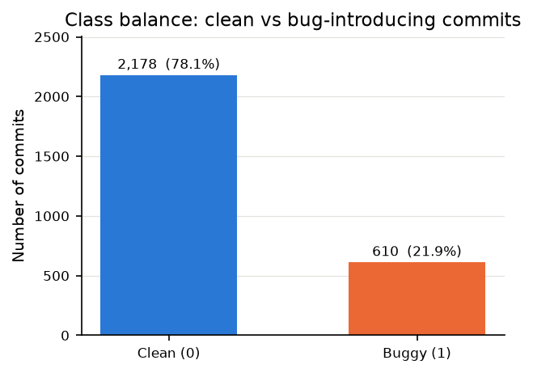

About 21.9% of commits are buggy, so there are roughly 3.6 clean commits for every buggy one. The bug rate also changes over time. It is 23.6% in the training period but only 15.1% in the test period. That makes the test set harder, since there are fewer buggy commits to find, and a random split would have hidden this.

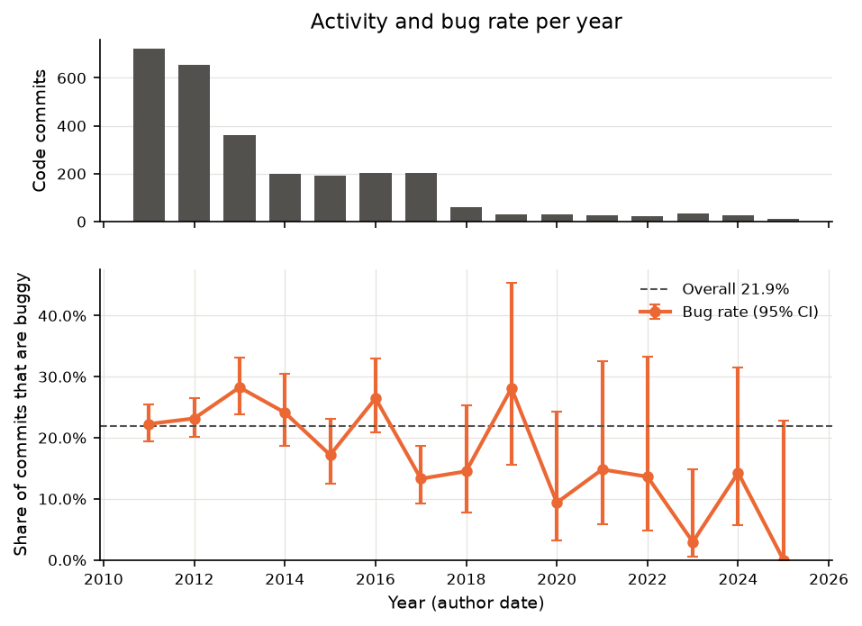

### 6.2 Which features separate buggy and clean commits?

We compared each feature between buggy and clean commits using the Mann-Whitney U test, which doesn't assume normal data, and Cliff's delta as the effect size.

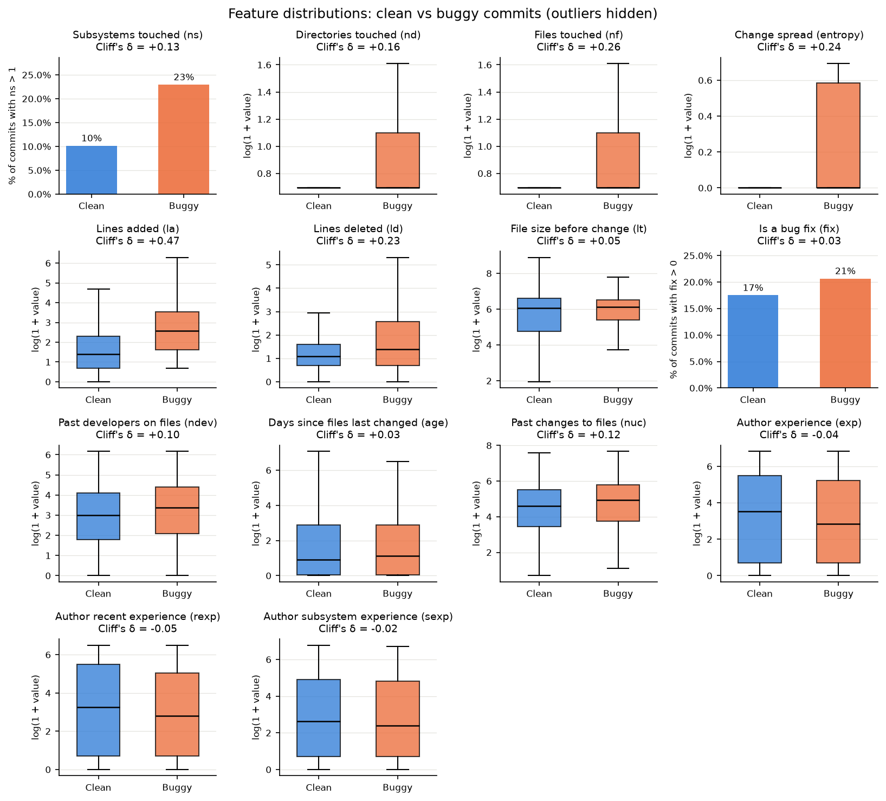

Eight of the 14 features differ significantly (p < 0.05). The strongest single signal is lines added. The median buggy commit adds 12 lines while the median clean one adds 3 (Cliff's delta of +0.47, a medium effect). The diffusion features come next: files touched (+0.26), entropy (+0.24), lines deleted (+0.23) and directories (+0.16). Author experience and the fix flag barely differ on their own.

Every distribution overlaps a lot with the other class, though. No single metric can separate buggy from clean, which is why we need a model that combines them.

### 6.3 Correlation between features

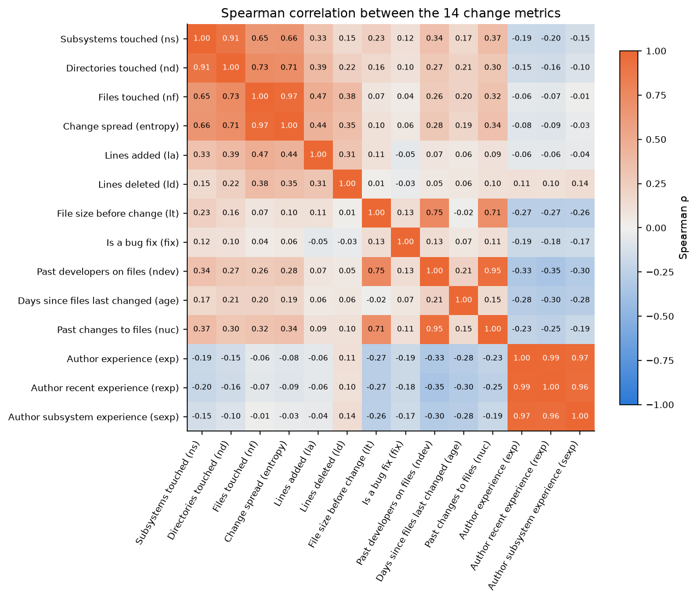

Six pairs of features have a Spearman correlation above 0.8: `exp` and `rexp` (0.99), `nf` and `entropy` (0.97), `exp` and `sexp` (0.97), `rexp` and `sexp` (0.96), `ndev` and `nuc` (0.95), and `ns` and `nd` (0.91). Correlated features don't hurt the accuracy of tree ensembles much. They can, however, split credit between each other in the explanations and make linear model weights unstable. We kept all 14 so our results stay comparable with other work, and we come back to this problem in Section 8.4.

### 6.4 PCA, kernel PCA and t-SNE

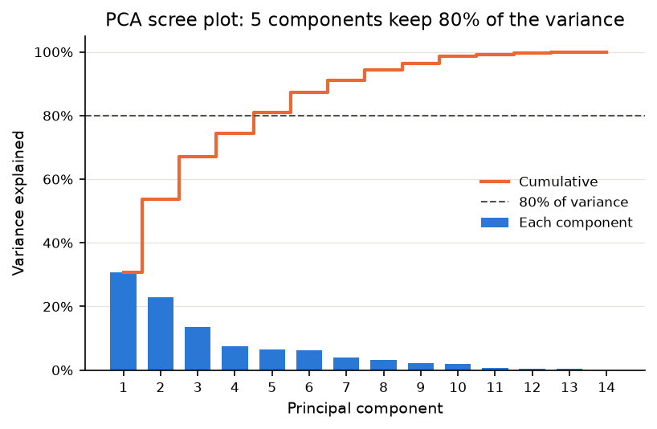

PCA needs 5 of the 14 components to explain 80% of the variance, and the first component alone covers 31%. That first component roughly measures how spread out and how busy a change is (`ns`, `ndev`, `nd`), while the second one is mostly author experience.

In the 2D plots from PCA, kernel PCA (RBF) and t-SNE, buggy and clean commits overlap. For a buggy commit, about 28 to 31% of its nearest neighbours are also buggy, compared with 22% you'd expect by chance. So the classes can only be separated weakly, and we shouldn't expect any classifier to come close to perfect.

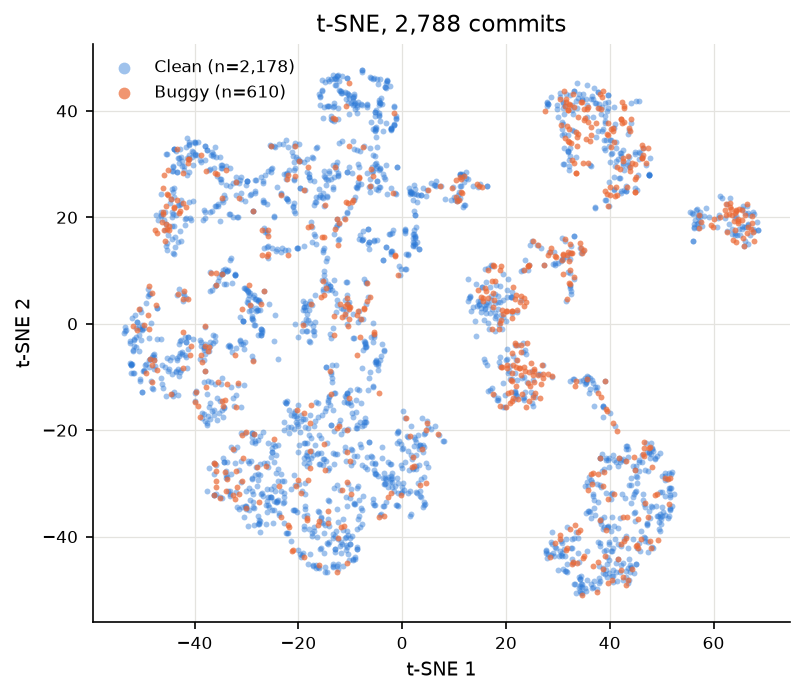

### 6.5 Clustering into commit types

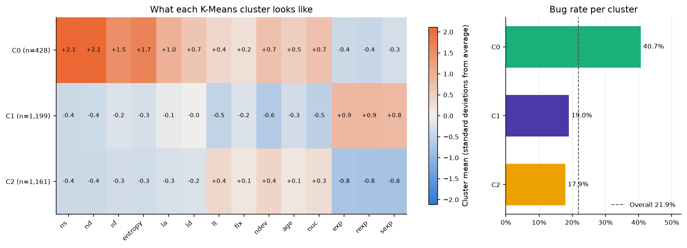

K-Means with k = 3 (chosen using the silhouette score) gives three groups that are easy to describe.

| Cluster | Size | Bug rate | What the typical commit looks like (medians) |
|---|---|---|---|
| C0, cross-cutting changes | 428 | 40.7% | touches 2 subsystems and 2 files, adds 19 lines, high entropy, files with 310 earlier changes |
| C1, experienced authors | 1,199 | 19.0% | small change (3 lines) by an author with about 284 earlier commits |
| C2, newcomers | 1,161 | 17.9% | small change by an author with about 1 earlier commit |

Cross-cutting changes turn out to be buggy about twice as often as the other two groups, and the clustering never even saw the labels. Interestingly, small changes from newcomers aren't riskier than small changes from experienced authors in this project. Size and spread matter more than experience.

| Method | Type | Clusters | Silhouette | Bug rate range |
|---|---|---|---|---|
| K-Means | partitioning | 3 | 0.248 | 17.9% to 40.7% |
| Agglomerative (Ward) | hierarchical | 3 | 0.184 | 16.2% to 39.4% |
| DBSCAN | density-based | 2, plus 4% noise | 0.344 | 18.6% to 38.5% |

The commits DBSCAN marks as noise are the unusual ones that don't sit in any dense region, and 41.1% of them are buggy compared with 21.1% of the rest. In other words, unusual commits tend to be risky ones. All the silhouette scores are modest (0.18 to 0.34), so commits form more of a continuum than neat separate groups.

## 7. Models and Evaluation

The full tables are in `reports/model_comparison.md`. Running `uv run python -m riskpredictor.train` regenerates them in about 40 seconds.

### 7.1 Setup

| Part | Commits | Period | Bug rate |
|---|---|---|---|
| Training (oldest 80%) | 2,230 | Feb 2011 to Jun 2016 | 23.6% |
| Fitting part of training | 1,784 | Feb 2011 to Mar 2014 | 23.7% |
| Validation part of training (used only for the threshold) | 446 | Mar 2014 to Jun 2016 | 23.3% |
| Test (newest 20%) | 558 | Jun 2016 to Aug 2025 | 15.1% |

We used 5-fold `TimeSeriesSplit` cross-validation on the training period, so each fold trains on the past and validates on the block right after it. XGBoost, random forest, logistic regression and the RBF SVM were tuned with `RandomizedSearchCV` (25 candidates each, scored on ROC-AUC). For the imbalance we used balanced class weights (`scale_pos_weight` for XGBoost). The final model was picked by its mean cross-validated ROC-AUC on the training period, so the test scores played no part in the choice. Its decision threshold is the value that gave the best F1 on the validation slice.

### 7.2 Leaderboard

| # | Model | Type | CV ROC-AUC (train) | Test ROC-AUC | Test PR-AUC | F1 | Recall | MCC |
|---|---|---|---|---|---|---|---|---|
| 1 | **XGBoost** (tuned) | Boosting | **0.732 ± 0.029** | 0.779 | 0.401 | 0.410 | 0.798 | 0.307 |
| 2 | Random Forest (tuned) | Bagging | 0.727 ± 0.020 | 0.776 | 0.423 | 0.393 | 0.810 | 0.287 |
| 3 | SVM (linear) | Linear | 0.726 ± 0.030 | 0.762 | 0.349 | 0.396 | 0.774 | 0.286 |
| 4 | Logistic Regression (tuned) | Linear | 0.725 ± 0.040 | 0.769 | 0.362 | 0.386 | 0.679 | 0.261 |
| 5 | AdaBoost | Boosting | 0.725 ± 0.028 | 0.783 | 0.389 | 0.418 | 0.702 | 0.306 |
| 6 | SVM (RBF, tuned) | Kernel | 0.724 ± 0.042 | 0.768 | 0.358 | 0.397 | 0.845 | 0.298 |
| 7 | MLP (neural network) | Neural network | 0.708 ± 0.038 | 0.751 | 0.339 | 0.374 | 0.524 | 0.240 |
| 8 | Naive Bayes | Probabilistic | 0.700 ± 0.024 | 0.707 | 0.316 | 0.385 | 0.679 | 0.259 |
| 9 | k-NN | Instance-based | 0.673 ± 0.060 | 0.715 | 0.296 | 0.356 | 0.500 | 0.215 |
| 10 | Decision Tree (CART, entropy) | Tree | 0.664 ± 0.028 | 0.766 | 0.358 | 0.383 | 0.833 | 0.276 |
| 11 | Decision Tree (CART, gini) | Tree | 0.630 ± 0.027 | 0.750 | 0.351 | 0.347 | 0.905 | 0.236 |
| 12 | Perceptron | Linear | 0.628 ± 0.040 | 0.523 | 0.188 | 0.237 | 0.500 | 0.012 |
| 13 | One-Class SVM (anomaly baseline) | Anomaly detection | 0.605 ± 0.040 | 0.662 | 0.258 | 0.331 | 0.571 | 0.176 |

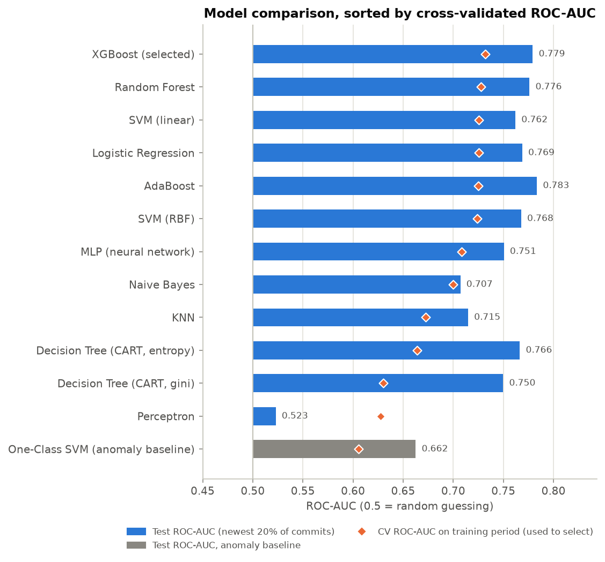

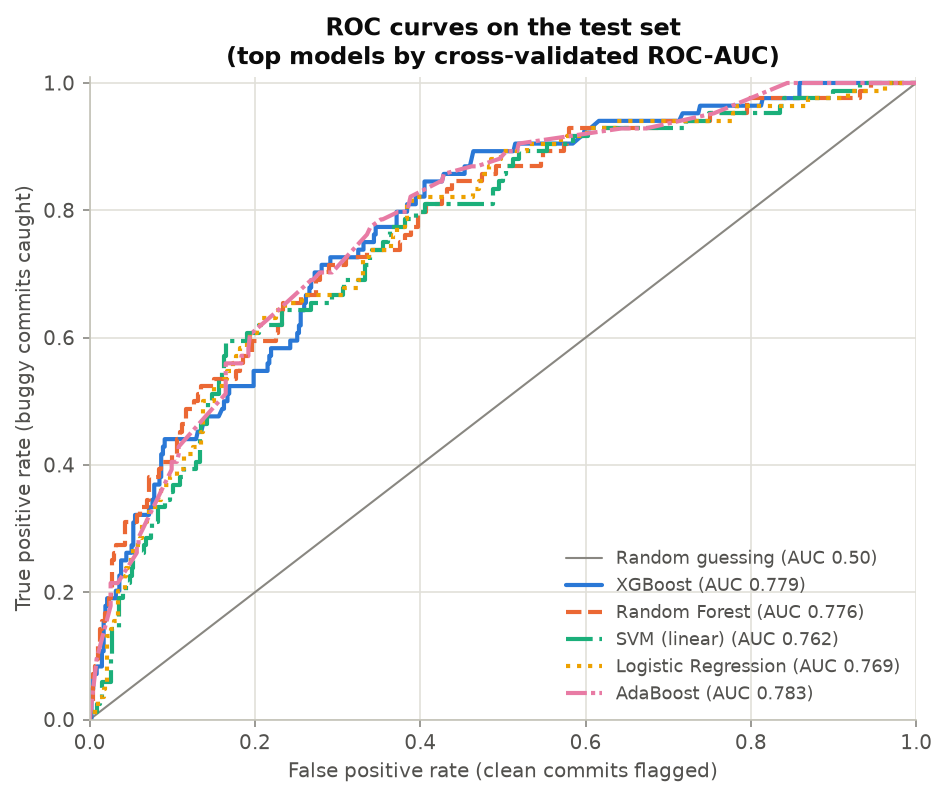

A few things stand out from this table.

The top seven models are basically tied, since their CV scores are all within one standard deviation of XGBoost's. The ensembles (XGBoost, random forest and AdaBoost) are always near the top, but a properly regularised logistic regression is almost as good. With only 14 features and noisy labels, the data sets the ceiling more than the algorithm does.

Single decision trees and the perceptron are clearly weaker and less stable. The trees overfit easily, and the perceptron doesn't produce useful probabilities. One note on naming: the entropy tree uses the same information gain idea as ID3, but scikit-learn always builds binary splits like CART, so it is a CART tree with the entropy criterion rather than a true ID3 tree.

The One-Class SVM never sees a single buggy commit during training, yet it still beats random guessing with a test ROC-AUC of 0.662. This backs up what we saw with clustering: unusual commits tend to be risky.

Most models actually score higher on the test set than in cross-validation, even though the test bug rate is lower (15.1% against 23.6%). The later history of `requests` is calmer, and its big risky commits are easier to spot. Keep in mind that PR-AUC should be compared with the test bug rate of 0.151, not with 0.5.

### 7.3 The selected model: XGBoost

After tuning, the model uses 108 trees of depth 2 with a learning rate of 0.018, row subsampling of 0.68, column subsampling of 0.65 and L2 regularisation of 3.5. These are shallow and heavily regularised trees, which makes sense for a small, noisy dataset. The decision threshold is 0.514.

| Metric on the test set (558 commits) | Value |
|---|---|
| ROC-AUC | 0.779 |
| PR-AUC | 0.401 (random gets 0.151) |
| Recall, precision, F1 | 0.798, 0.276, 0.410 |
| MCC, balanced accuracy | 0.307, 0.713 |
| Confusion matrix | 67 true positives, 176 false positives, 17 false negatives, 298 true negatives |
| Buggy commits found when reviewing the riskiest 20% of commits | 48% (40 of 84), 2.4 times random |

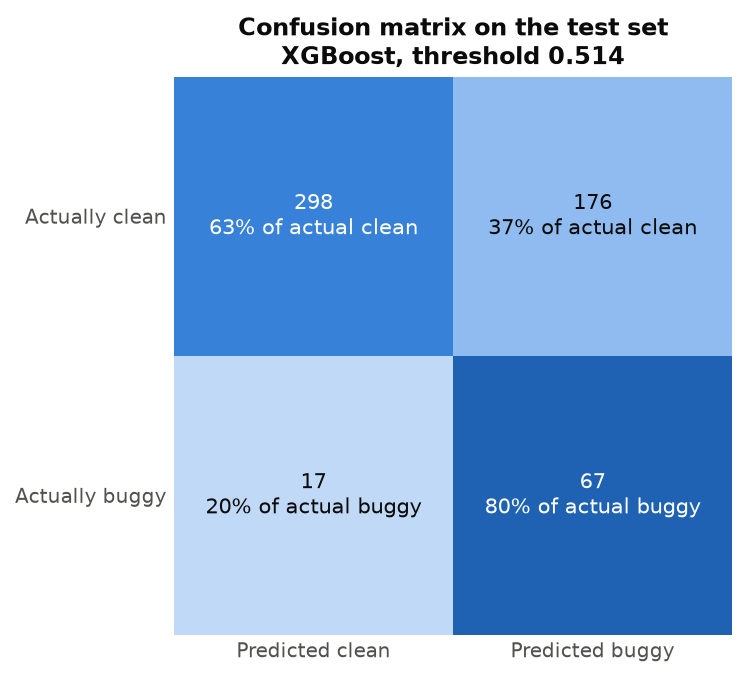

At this threshold the model leans towards recall. It catches 80% of the bug-introducing commits but flags 44% of all commits to get there. The threshold was chosen on a validation period where 23% of commits were buggy, so on the calmer test period it flags quite generously. In practice a team would set the threshold to match how much review time they have. The ranking number (48% of bugs in the top 20%) is the more useful summary.

If we measure effort in lines instead of commits, Recall@20% effort is low at 0.083. The model ranks big commits as the riskiest, and big commits use up a line-based review budget very quickly. Size is the strongest risk signal, but it is also exactly what makes a commit expensive to review. Kamei et al. (2013) pointed out the same tension.

### 7.4 Class imbalance

| Model and measure | No handling | Class weights | SMOTE |
|---|---|---|---|
| Logistic regression, CV ROC-AUC | 0.721 | 0.721 | 0.719 |
| Logistic regression, recall at threshold 0.5 | 0.31 | 0.74 | 0.74 |
| Random forest, CV ROC-AUC | 0.698 | 0.705 | 0.691 |
| Random forest, recall at threshold 0.5 | 0.29 | 0.67 | 0.56 |

Rebalancing barely changes how well the models rank commits (ROC-AUC moves by less than 0.015). What it does change is the probability scale. Without it, the default threshold of 0.5 misses about 70% of buggy commits. Once the threshold is tuned on validation data, all three options end up close. So the lesson is to either rebalance or tune the threshold, and not to use 0.5 blindly on imbalanced data.

One side effect is worth knowing about. With class weights, the probabilities shift upwards, so the "average commit" scores about 45% even though only 22% of commits are buggy. The scores should be read as relative risk, not as calibrated probabilities.

### 7.5 Hyperparameter tuning and bias versus variance

| Model | CV ROC-AUC with defaults | CV ROC-AUC after tuning |
|---|---|---|
| XGBoost | 0.673 | 0.732 |
| SVM (RBF) | 0.681 | 0.724 |
| Random Forest | 0.705 | 0.727 |
| Logistic Regression | 0.721 | 0.725 |

Tuning helps the flexible models the most. XGBoost's default trees (depth 6) overfit, and the search moved it to shallow depth-2 trees with strong regularisation.

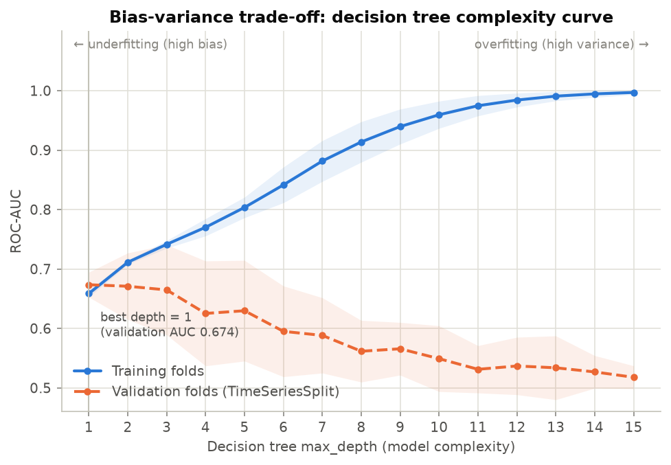

The decision tree complexity curve shows the trade-off directly. As `max_depth` grows, the training ROC-AUC climbs towards 1.0 because bias falls. The validation ROC-AUC peaks at depth 1 (0.674) and then goes down. At depth 15 the tree scores 0.997 on its training folds but only 0.518 on validation, which means it has basically memorised the training commits. Ensembles get around this either by averaging many trees (bagging, as in random forest) or by adding many weak, shallow trees one after another (boosting, as in AdaBoost and XGBoost).

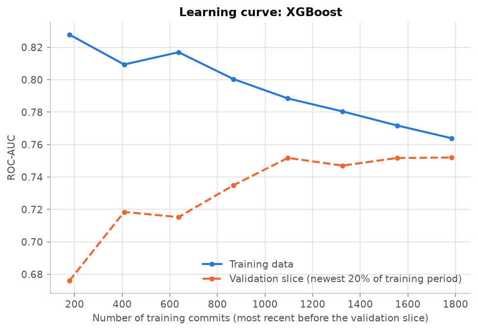

In the learning curve for the selected model, the two lines come together. Training ROC-AUC falls from 0.83 to 0.76 as the model can no longer memorise everything, while validation ROC-AUC rises from 0.68 and levels off around 0.75 after roughly 1,100 commits. The small gap left over means variance is under control. The flat part at the end tells us that more commits from this same project wouldn't help much. Further gains would need better features or cleaner labels.

## 8. Explainability

### 8.1 What drives risk overall?

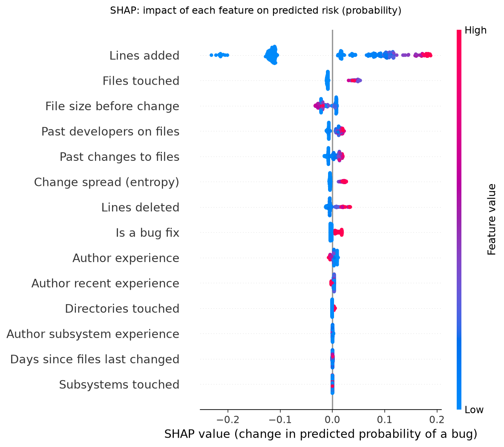

Mean absolute SHAP value for the XGBoost model, in percentage points of predicted risk:

| Rank | Feature | Mean SHAP (points) | Effect |
|---|---|---|---|
| 1 | Lines added (`la`) | 11.0 | more lines, more risk |
| 2 | Files touched (`nf`) | 1.9 | more files, more risk |
| 3 | File size before change (`lt`) | 1.4 | larger files are slightly safer |
| 4 | Past developers on files (`ndev`) | 1.2 | more developers, more risk |
| 5 | Past changes to files (`nuc`) | 1.0 | busier files, more risk |
| 6 | Change spread (`entropy`) | 0.9 | more scattered, more risk |
| 7 | Lines deleted (`ld`) | 0.8 | more deletions, more risk |
| 8 | Is a bug fix (`fix`) | 0.5 | fixes are riskier |
| 9 | Author experience (`exp`) | 0.4 | experienced authors are safer |

Size dominates. Lines added contributes more than all the other features put together, which fits the EDA (it had the largest effect size in Section 6.2). The other signals line up with the software engineering literature too. Scattered changes (Hassan, 2009), files that many people have touched and bug-fixing commits all raise the risk, the last one because fixes are often incomplete. Larger existing files are slightly safer per change, which matches the known result that big files have a lower defect density. Every direction the model learned makes intuitive sense, and that is good evidence it picked up real patterns rather than noise.

### 8.2 Why is this particular commit risky?

For every commit, SHAP breaks the prediction into a sum: the average risk of past commits, plus one contribution per feature, equals this commit's risk. Our tool takes the biggest contributions and turns them into sentences, comparing each value with past commits.

```
Commit 85400d8d: Allow use of 'no_proxy' in the proxies argument   (actual label: buggy)
Predicted risk : 76.1%  (High risk, FLAGGED as risky; threshold 51.4%)
Average commit : 44.8%

Factors raising the risk:
  1. Adds 91 lines, more than 96% of past commits, which raises the risk by 18.0 percentage points.
  2. Modifies 3 files, more than 94% of past commits, which raises the risk by 3.9 percentage points.
  3. Spreads its changes across files with entropy 0.88, higher than 90% of past commits, which raises the risk by 2.4 percentage points.
```

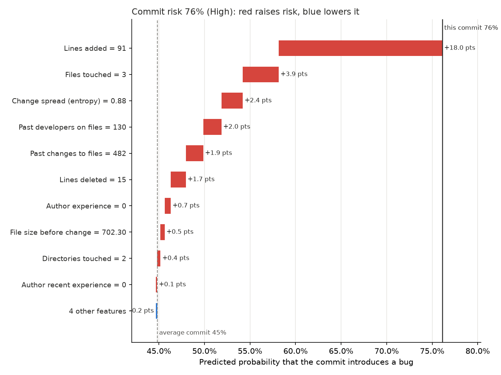

### 8.3 SHAP compared with LIME

LIME explains the same prediction in a different way. It fits a small linear model around the commit using perturbed copies of it. For the same commit as above, LIME also puts lines added far ahead of everything else:

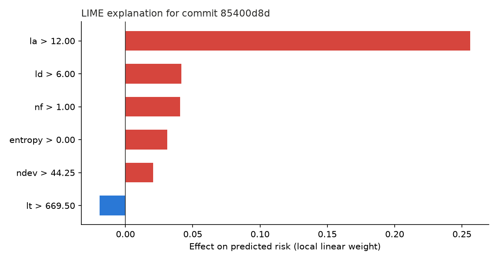
 Over 50 test commits, the two methods agreed on 60% of the top three features on average, with a mean Spearman rank correlation of 0.63. So they mostly agree on what matters but differ in the details. We use SHAP in the app because its values add up exactly to the prediction and it gives the same answer every time, while LIME depends on random sampling and on how it bins the features.

### 8.4 A lesson about correlated features

For a while during development, the selected model was a logistic regression. Its explanations had contradictions that any reviewer would spot straight away, such as "modifies 3 files, which lowers the risk", or more subsystem experience raising the risk. The cause was the multicollinearity from Section 6.3. `nf` and `entropy` (0.97), and `exp` and `sexp` (0.97), carry almost the same information, so the linear model gave each pair large weights with opposite signs that cancel each other out. The accuracy was fine, but the explanations couldn't be trusted. The tuned XGBoost model uses shallow trees and samples columns, and it doesn't learn any of these reversals. The takeaway is that good accuracy doesn't guarantee good explanations. You have to check that the explanations make sense too.

## 9. Application

We built a Streamlit app so the model can actually be used. Start it with `uv run streamlit run app/streamlit_app.py`.

**Overview.** The size of the dataset, the bug rate over time and how buggy commits differ from clean ones.

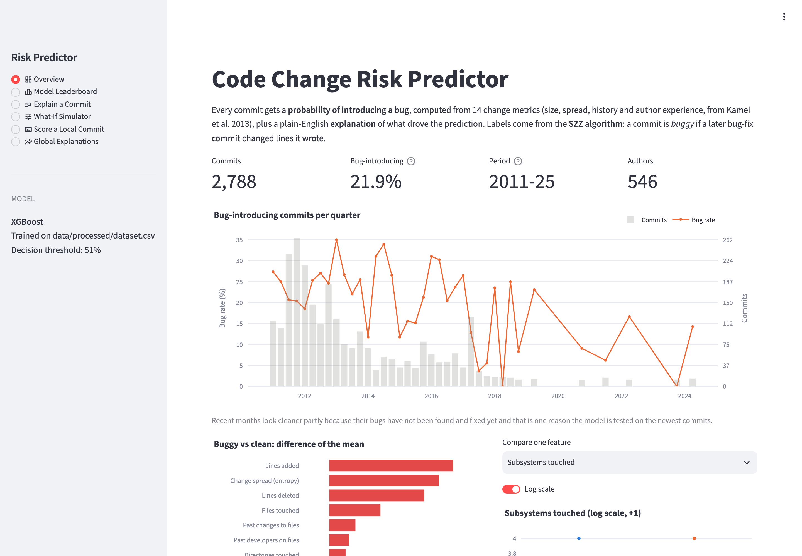

**Model leaderboard.** Every algorithm's scores, the selected model and how it was chosen.

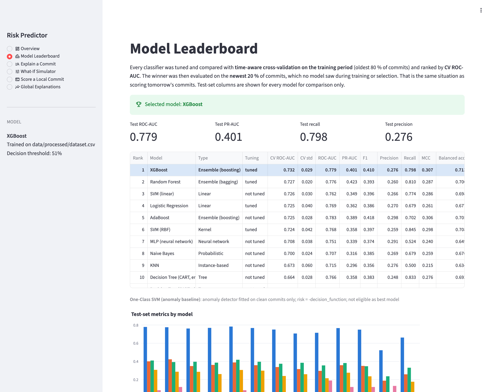

**Explain a commit.** Pick any commit from the test period to see a risk gauge, the risk level, the main reasons in plain English, the SHAP chart, LIME weights and the commit's real SZZ label for comparison.


**What-if simulator.** Change a commit's features (for example, halve its size as if it were split into two commits) and the risk and explanation update straight away. A "suggest how to lower risk" button tries a few realistic changes automatically.

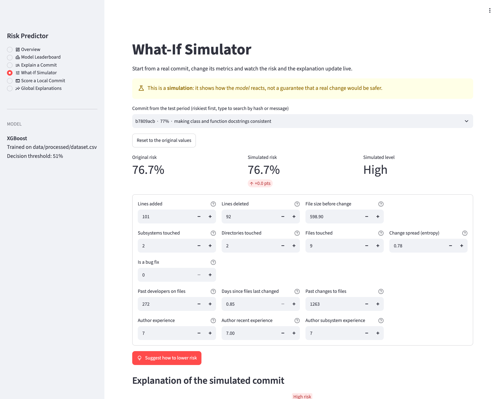

**Score a local commit.** Point it at any git repository on your computer and a commit hash. It mines the history up to that commit and scores it, which takes about 45 seconds on `requests`. The example below scores the newest change to the library's source code.

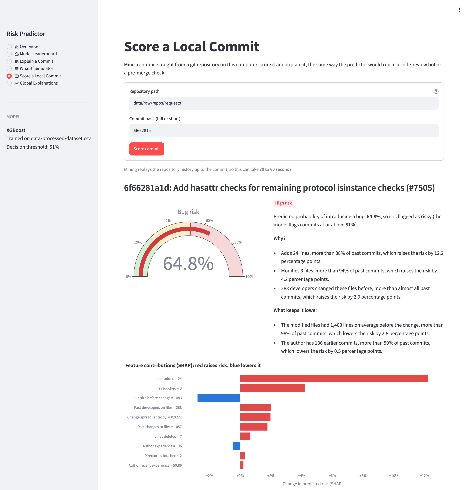

**Global explanations.** Which features matter most across all commits.

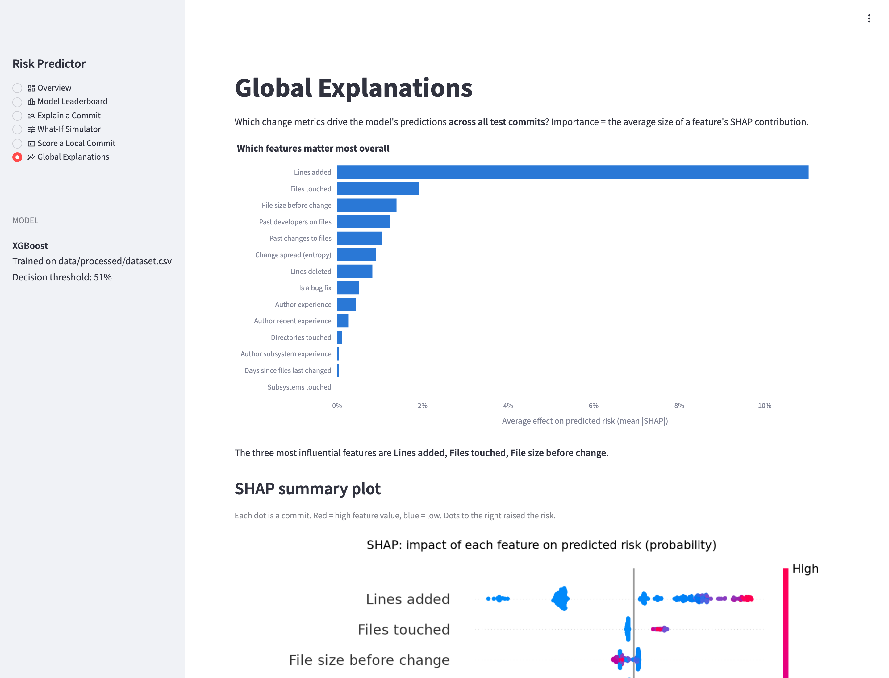

The same scoring is available from the command line, which is handy for scripts or a CI check: `uv run riskpredictor score --repo <path> --commit <hash>`.

## 10. Results and Discussion

**Which algorithm should be used?** On this data we'd recommend gradient-boosted trees (XGBoost). It ranked first in cross-validation, copes well with skewed features, needs no feature selection despite the strong correlations and gives explanations that make sense feature by feature. Random forest is almost as good. If simplicity matters most, a regularised logistic regression is within one standard deviation on accuracy, but its explanations need care because of the correlated features (Section 8.4).

**Is the model useful?** A reviewer who checks the 20% of commits ranked riskiest finds 48% of the bug-introducing ones, compared with 20% if they picked at random. Every flag also comes with a reason a developer can act on. The most common one is simply "this commit is large, consider splitting it".

**Threats to validity.**

- *Noisy labels.* SZZ is a heuristic. For example, the commit "Add automatic code formatting" is labelled buggy only because later fixes touched lines it had reformatted. And some clean commits contain bugs that were simply never fixed.
- *One project.* All of our results come from `requests`. Other projects have different bug rates and habits, so the model should be retrained, or at least checked on another project, before being used there.
- *Drift.* The test period's bug rate (15.1%) is different from the training period's (23.6%), and a threshold chosen on older data flags generously on newer data. A deployed model would need retraining and a new threshold from time to time.
- *Slightly optimistic CV for tuned models.* Their CV score is the best of 25 candidates. Nested cross-validation would remove that bias but takes five times longer.

## 11. Conclusion and Future Work

We built a complete, explainable just-in-time defect predictor. It includes a mining and labelling pipeline that can turn any git repository into a labelled dataset, a comparison of 13 classic algorithms under a realistic time-based setup, SHAP and LIME explanations written out as plain-English risk reports, and an interactive app with a what-if simulator.

The best model, a tuned XGBoost, reaches a test ROC-AUC of 0.779 and puts about half of all bug-introducing commits into the riskiest fifth. More than anything, the project showed us that in this area a simple, well-explained model is worth more than a slightly more accurate black box, because reviewers need to know why a change is risky before they can do anything about it.

**Future work.**

- Mine more projects and test cross-project prediction, training on one repository and predicting on another.
- Use a stronger SZZ variant that ignores refactorings and cosmetic changes, to cut down label noise.
- Add features that look at the content of the diff itself, for example token-based models.
- Make scoring incremental, so a git hook could score each new commit in under a second without replaying the whole history.

## References

1. J. Śliwerski, T. Zimmermann and A. Zeller, "When Do Changes Induce Fixes?", *Proc. Int. Workshop on Mining Software Repositories (MSR)*, 2005.
2. A. E. Hassan, "Predicting Faults Using the Complexity of Code Changes", *Proc. Int. Conf. on Software Engineering (ICSE)*, 2009.
3. Y. Kamei, E. Shihab, B. Adams, A. E. Hassan, A. Mockus, A. Sinha and N. Ubayashi, "A Large-Scale Empirical Study of Just-in-Time Quality Assurance", *IEEE Transactions on Software Engineering*, 39(6), 2013.
4. D. Spadini, M. Aniche and A. Bacchelli, "PyDriller: Python Framework for Mining Software Repositories", *Proc. ESEC/FSE*, 2018.
5. N. V. Chawla, K. W. Bowyer, L. O. Hall and W. P. Kegelmeyer, "SMOTE: Synthetic Minority Over-sampling Technique", *Journal of Artificial Intelligence Research*, 16, 2002.
6. L. Breiman, "Random Forests", *Machine Learning*, 45(1), 2001.
7. T. Chen and C. Guestrin, "XGBoost: A Scalable Tree Boosting System", *Proc. ACM SIGKDD*, 2016.
8. M. T. Ribeiro, S. Singh and C. Guestrin, "'Why Should I Trust You?': Explaining the Predictions of Any Classifier", *Proc. ACM SIGKDD*, 2016.
9. S. M. Lundberg and S.-I. Lee, "A Unified Approach to Interpreting Model Predictions", *Advances in Neural Information Processing Systems (NeurIPS)*, 2017.
